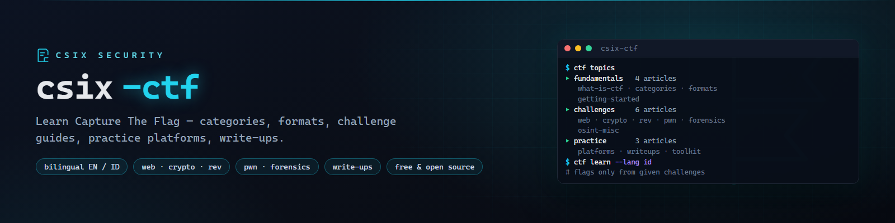

# csix-ctf



**Basis belajar Capture The Flag gratis dua bahasa (EN/ID) — kategori, format, panduan tantangan web/crypto/rev/pwn/forensics, platform latihan, dan menulis write-up.**

[](https://github.com/siedysoes/csix-ctf/actions/workflows/ci.yml)
[](LICENSE)
[](https://siedysoes.github.io/csix-ctf/)

`csix-ctf` adalah basis pengetahuan yang terstruktur dan ramah pemula untuk
belajar kompetisi Capture The Flag — artikel pendek, praktis, dan saling
terhubung yang menjelaskan cara CTF bekerja, cara menghadapi tiap jenis
tantangan, dan di mana berlatih.

> ⚠️ **Khusus tantangan.** Semua di sini tentang memecahkan teka-teki yang
> diberikan kepada Anda — di kompetisi, platform, dan lab milik Anda sendiri.
> Jangan pernah memakai teknik ini untuk menyerang sistem yang tidak Anda
> miliki atau tanpa izin mengujinya.

> 🌐 **Baca di web:** **https://siedysoes.github.io/csix-ctf/**

## Isi

### Fundamental (4 artikel)

| Artikel | Yang akan Anda pelajari |
|---------|-------------------------|
| [Apa Itu CTF](id/fundamentals/what-is-ctf.md) | Format flag, sejarah, kenapa CTF membangun skill nyata |
| [Kategori CTF](id/fundamentals/ctf-categories.md) | Web, crypto, rev, pwn, forensics, misc, OSINT — tiap kategori menguji apa |
| [Format & Skor](id/fundamentals/competition-formats.md) | Jeopardy vs attack-defense, skor dinamis, CTFtime |
| [Memulai di CTF](id/fundamentals/getting-started.md) | Strategi event pertama, manajemen waktu, kerja tim |

### Jenis Tantangan (6 artikel)

| Artikel | Yang akan Anda pelajari |
|---------|-------------------------|
| [Tantangan Web Exploitation](id/challenges/web.md) | SQLi, XSS, cookie, IDOR, pola web CTF umum |
| [Tantangan Kriptografi](id/challenges/crypto.md) | Encoding, cipher klasik, XOR, dasar RSA, tooling |
| [Tantangan Reverse Engineering](id/challenges/reversing.md) | strings → disassembly → Ghidra, alur crackme |
| [Tantangan Binary Exploitation](id/challenges/pwn.md) | Tata letak stack, konsep overflow, proteksi, latihan gaya CTF |
| [Tantangan Forensik](id/challenges/forensics.md) | binwalk, steg, carving, analisis PCAP, dasar memori |
| [OSINT & Tantangan Misc](id/challenges/misc-osint.md) | Dorking, metadata, OSINT gambar, trik misc klasik |

### Latihan & Sumber Daya (3 artikel)

| Artikel | Yang akan Anda pelajari |
|---------|-------------------------|
| [Platform Latihan](id/practice/platforms.md) | picoCTF, OverTheWire, CryptoHack, HTB, CTFtime — tabel fokus/biaya |
| [Menulis Write-up](id/practice/writeups.md) | Struktur, nilai edukatif, etika spoiler, publikasi |
| [Toolkit CTF](id/practice/toolkit.md) | Tabel tool per kategori, tips setup |

Setiap artikel tersedia dalam **English** (`en/`) dan **Bahasa Indonesia** (`id/`).

## Baca di web

Situsnya adalah aplikasi statis satu halaman (tanpa server, tanpa pelacakan)
yang dijalankan GitHub Pages — merender file Markdown dari repo ini secara langsung:

- 🌐 **https://siedysoes.github.io/csix-ctf/**
- Tombol ganti bahasa **EN ↔ ID** di bar atas
- Kotak pencarian memfilter topik saat Anda mengetik
- Link di dalam artikel navigasi tanpa reload halaman

## Struktur repositori

```
csix-ctf/
├── index.html        # cangkang aplikasi web
├── app.js            # router + pencarian + ganti bahasa
├── style.css         # tema gelap
├── topics.json       # manifest topik (judul + jalur, EN/ID)
├── assets/           # banner
├── en/               # artikel English
│   ├── fundamentals/
│   ├── challenges/
│   └── practice/
├── id/               # artikel Indonesia
│   ├── fundamentals/
│   ├── challenges/
│   └── practice/
└── .github/workflows # CI: validasi link + manifest
```

## Berlatih dengan aman

- Hanya pecahkan tantangan yang diberikan platform, kompetisi, atau lab milik
  Anda sendiri (lihat
  [panduan home lab CSIX Wiki](https://siedysoes.github.io/csix-wiki/#/en/practical/hands-on-lab)).
- Fitur dan harga platform bisa berubah — cocokkan detail terkini di situs
  resmi mereka sebelum mengandalkannya.

## Berkontribusi

1. Fork, lalu tambah/ubah Markdown di `en/` (dan terjemahkan di `id/`).
2. Daftarkan topik baru di `topics.json` (kedua bahasa).
3. Buka pull request — CI memastikan semua link dan entri manifest valid.

Gaya artikel: Markdown murni, tanpa front matter, baris pertama `# Judul`,
diakhiri satu bagian `## Lihat juga` berisi link relatif.

## Bahasa

- [English](README.md)
- Bahasa Indonesia (file ini)

## Lisensi

MIT — lihat [LICENSE](LICENSE). Konten bebas dipelajari, dibagikan, dan
diadaptasi dengan atribusi.
