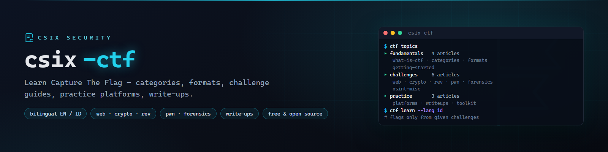

# csix-ctf



**Free bilingual (EN/ID) Capture The Flag learning base — categories, formats, challenge guides for web/crypto/rev/pwn/forensics, practice platforms, and write-up writing.**

[](https://github.com/siedysoes/csix-ctf/actions/workflows/ci.yml)
[](LICENSE)
[](https://siedysoes.github.io/csix-ctf/)

`csix-ctf` is a structured, beginner-friendly knowledge base for learning
Capture The Flag competitions — short, practical, cross-linked articles covering
how CTFs work, how to approach each challenge type, and where to practice.

> ⚠️ **Challenges only.** Everything here is about solving puzzles that are
> given to you — in competitions, platforms, and your own lab. Never use these
> techniques against systems you do not own or lack permission to test.

> 🌐 **Read it on the web:** **https://siedysoes.github.io/csix-ctf/**

## What's inside

### Fundamentals (4 articles)

| Article | You'll learn |
|---------|--------------|
| [What Is a CTF](en/fundamentals/what-is-ctf.md) | Flag format, history, why CTFs build real skills |
| [CTF Categories](en/fundamentals/ctf-categories.md) | Web, crypto, rev, pwn, forensics, misc, OSINT — what each tests |
| [Formats & Scoring](en/fundamentals/competition-formats.md) | Jeopardy vs attack-defense, dynamic scoring, CTFtime |
| [Getting Started in CTFs](en/fundamentals/getting-started.md) | First event strategy, time management, teamwork |

### Challenge Types (6 articles)

| Article | You'll learn |
|---------|--------------|
| [Web Exploitation Challenges](en/challenges/web.md) | SQLi, XSS, cookies, IDOR, common CTF web patterns |
| [Cryptography Challenges](en/challenges/crypto.md) | Encodings, classical ciphers, XOR, RSA basics, tooling |
| [Reverse Engineering Challenges](en/challenges/reversing.md) | strings → disassembly → Ghidra, crackme workflow |
| [Binary Exploitation Challenges](en/challenges/pwn.md) | Stack layout, overflow concept, protections, CTF-style practice |
| [Forensics Challenges](en/challenges/forensics.md) | binwalk, steg, carving, PCAP analysis, memory basics |
| [OSINT & Misc Challenges](en/challenges/misc-osint.md) | Dorking, metadata, image OSINT, classic misc tricks |

### Practice & Resources (3 articles)

| Article | You'll learn |
|---------|--------------|
| [Practice Platforms](en/practice/platforms.md) | picoCTF, OverTheWire, CryptoHack, HTB, CTFtime — with focus/cost table |
| [Writing Write-ups](en/practice/writeups.md) | Structure, teaching value, spoiler etiquette, publishing |
| [The CTF Toolkit](en/practice/toolkit.md) | Category-by-category tool table, setup tips |

Every article exists in **English** (`en/`) and **Indonesian** (`id/`).

## Read on the web

The site is a static single-page app (no server, no tracking) served by
GitHub Pages — it renders the Markdown files from this repo live:

- 🌐 **https://siedysoes.github.io/csix-ctf/**
- Language toggle **EN ↔ ID** in the top bar
- Search box filters topics as you type
- In-article links navigate without page reloads

## Repository layout

```
csix-ctf/
├── index.html        # web app shell
├── app.js            # router + search + language toggle
├── style.css         # dark theme
├── topics.json       # topic manifest (titles + paths, EN/ID)
├── assets/           # banner
├── en/               # English articles
│   ├── fundamentals/
│   ├── challenges/
│   └── practice/
├── id/               # Indonesian articles
│   ├── fundamentals/
│   ├── challenges/
│   └── practice/
└── .github/workflows # CI: link + manifest validation
```

## Practice safely

- Only solve challenges handed to you by a platform, competition, or your own
  lab (see the
  [CSIX Wiki home lab guide](https://siedysoes.github.io/csix-wiki/#/en/practical/hands-on-lab)).
- Platform features and pricing change — verify current details on their
  official sites before relying on them.

## Contribute

1. Fork and add/edit Markdown under `en/` (and translate under `id/`).
2. Register new topics in `topics.json` (both languages).
3. Open a pull request — CI checks that all links and manifest entries resolve.

Article style: pure Markdown, no front matter, `# Title` first line,
one `## See also` section with relative links at the end.

## Languages

- English (this file)
- [Bahasa Indonesia](README.id.md)

## License

MIT — see [LICENSE](LICENSE). Content is free to learn from, share, and adapt
with attribution.
